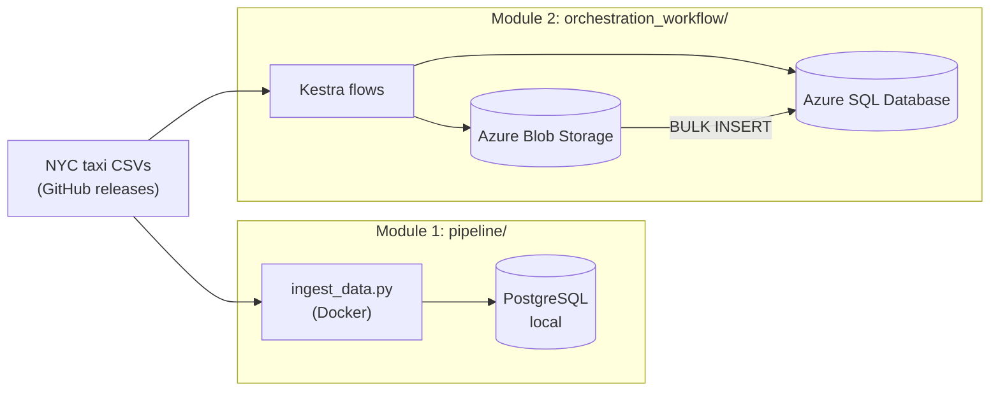

# Data Engineering Zoomcamp: My Course Work

This repo holds my work for the
[DataTalksClub Data Engineering Zoomcamp](https://github.com/DataTalksClub/data-engineering-zoomcamp),
a free hands-on course in building data pipelines.

Every module uses the same dataset: **NYC Taxi & Limousine Commission trip records** (yellow and green
taxis, 2019–2021) from the course's [nyc-tlc-data releases](https://github.com/DataTalksClub/nyc-tlc-data/releases).
The project takes that raw monthly CSV data from the internet into a database and then a cloud data
warehouse. Each module adds a new layer of tooling.

The course teaches the cloud parts on **Google Cloud Platform**. **I built them on Microsoft Azure
instead.** I translated the GCP services, auth model and SQL dialect to their Azure equivalents.

## What's in here

| Module | Folder | What it does | Main tools |
|---|---|---|---|
| 1. Containerization & ingestion | [`pipeline/`](pipeline/) | Python script that streams a month of taxi data into Postgres in chunks, packaged as a Docker image | Docker, Docker Compose, PostgreSQL, pgAdmin, pandas, SQLAlchemy, uv |
| 2. Workflow orchestration | [`orchestration_workflow/`](orchestration_workflow/) | Kestra flows that download each month, upload it to a data lake and load it into a warehouse, with de-duplication | Kestra, Azure Blob Storage, Azure SQL Database, Microsoft Entra ID |



## Module 1: Docker + Postgres ingestion (`pipeline/`)

- **`ingest_data.py`** reads a month of yellow taxi data straight from the source URL with pandas.
  - Reads it in chunks of 100k rows, with explicit column types.
  - Writes it to Postgres through SQLAlchemy.
  - Takes its connection, year/month and table name from the command line (`click`).
- **`Dockerfile`** builds a slim Python 3.13 image and installs the locked dependencies with `uv`.
- **`docker-compose.yml`** runs Postgres 18 and pgAdmin on a shared network.

```bash
cd pipeline
docker compose up -d                      # Postgres on localhost:5433, pgAdmin on localhost:8085
docker build -t taxi_ingest:v001 .

docker run -it --rm --network=pipeline_default taxi_ingest:v001 \
  --pg-user=root --pg-pass=root --pg-host=pgdatabase --pg-port=5432 --pg-db=ny_taxi \
  --target-table=yellow_taxi_trips_2021_2 --year=2021 --month=2
```

## Module 2: Kestra on Azure (`orchestration_workflow/`)

Three Kestra flows: one stores the Azure config, one creates the container and schema, and one loads
any taxi type, year and month. The taxi load flow:
1. Downloads the CSV.
2. Uploads it to Blob Storage.
3. Loads it into a staging table with `BULK INSERT`.
4. Builds a typed monthly table with an MD5 `unique_row_id`.
5. Merges new rows into the main table, so re-running a month never creates duplicates.

Setup steps, the full GCP → Azure mapping and the issues I debugged along the way are in
**[orchestration_workflow/README.md](orchestration_workflow/README.md)**.

## Key takeaways

- **Containers make pipelines portable:** the same image runs locally or anywhere Docker runs, and Compose wires up the database and tools.
- **Load in chunks:** streaming millions of rows keeps memory flat.
- **Orchestration adds structure:** parameterised, re-runnable and observable flows instead of one-off scripts.
- **Idempotent loads:** hashing a natural key and inserting only new rows makes backfills safe to repeat.
- **Porting between clouds is more than renaming services:** auth (service principal vs. service account),
  SQL dialect (T-SQL vs. BigQuery SQL) and tool quirks all needed rework.

## Security notes

- Secrets live in `orchestration_workflow/.env_encoded`, which is **gitignored**. Flows only refer to them through `{{ secret('...') }}` and `{{ kv('...') }}`.
- The `root`/`root` and `admin` credentials in the compose files are local development defaults only.

## Prerequisites

- Docker Desktop
- Python 3.13 + [uv](https://docs.astral.sh/uv/) (for running module 1 locally)
- An Azure subscription (for module 2)
