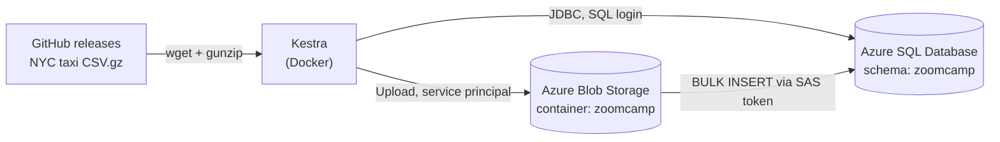

# Workflow Orchestration with Kestra (Azure)

This folder holds the workflow orchestration module of the
[DataTalksClub Data Engineering Zoomcamp](https://github.com/DataTalksClub/data-engineering-zoomcamp).
The course builds these pipelines on **Google Cloud** (GCS + BigQuery). This project ports them to
**Microsoft Azure**: Blob Storage stands in for GCS and Azure SQL Database stands in for BigQuery.

[Kestra](https://kestra.io) is the orchestrator. It downloads the NYC taxi data, uploads it to the
data lake and loads it into the warehouse. Every step is defined in YAML.

## Architecture



## Files

| File | Kestra flow | Purpose |
|---|---|---|
| `docker-compose.yml` | – | Runs Kestra and its Postgres metadata DB, plus a local Postgres and pgAdmin |
| `keskra_azure_kv.yaml` | `06_azure_kv` | Saves the Azure resource names and IDs to Kestra's KV Store |
| `keskra_azure_steup.yaml` | `07_azure_setup` | Creates the blob container and SQL schema if they don't exist |
| `keskra_azure_taxi.yaml` | `08_azure_taxi` | Downloads one month of taxi data, uploads it to Blob Storage, loads it into Azure SQL |
| `.env_encoded` | – | Secrets for the Kestra container. **Gitignored: never commit it** |

## GCP → Azure mapping

| Course (GCP) | This project (Azure) |
|---|---|
| GCP project ID | Subscription + resource group `zoomcamp-rg` |
| Region `europe-west2` | Region `uksouth` |
| GCS bucket | Storage account + blob container `zoomcamp` |
| BigQuery dataset | Azure SQL Database, schema `zoomcamp` |
| Service account JSON key | Microsoft Entra **service principal** (`kestra-sp`) |
| `gcs.Upload` | `azure.storage.blob.Upload` |
| BigQuery external table on GCS | Staging table loaded with `BULK INSERT` from Blob Storage |
| `CREATE OR REPLACE TABLE ... AS SELECT` | `DROP TABLE IF EXISTS` + `SELECT ... INTO` |
| `MD5(...)` → `BYTES` | `HASHBYTES('MD5', ...)` → `VARBINARY(16)` |
| `PARTITION BY DATE(pickup)` | Index on the pickup datetime |
| `MERGE ... WHEN NOT MATCHED` | `INSERT ... WHERE NOT EXISTS` (see [Lessons learned](#lessons-learned)) |

## How the taxi flow works (`08_azure_taxi`)

Inputs: **taxi** (`yellow` / `green`), **year** and **month**.

1. **extract**: downloads `<taxi>_tripdata_<year>-<month>.csv.gz` from the course's GitHub releases and unzips it.
2. **upload_to_blob**: uploads the CSV to the `zoomcamp` blob container.
3. **sql_blob_data_source**: sets up Azure SQL's access to the container: a master key, a database-scoped
   credential holding the SAS token, and an external data source. It runs on every execution, so a renewed SAS token takes effect on the next run.
4. **Create the main table**: `zoomcamp.<taxi>_tripdata`, created on the first run only.
5. **Staging table** `<taxi>_tripdata_<year>_<month>_ext`: filled with `BULK INSERT` straight from Blob
   Storage. Every column is text, so a malformed value in the raw CSV can't fail the load.
6. **Monthly table** `<taxi>_tripdata_<year>_<month>`: values converted with `TRY_CAST`, plus two added columns:
   - `unique_row_id`: an MD5 hash of vendor, pickup/dropoff time and pickup/dropoff location
   - `filename`: the source file the row came from

   The staging table is dropped afterwards to save space.
7. **Merge into the main table**: inserts only rows whose `unique_row_id` isn't already present.
   Re-running the same month adds no duplicates.
8. **purge_files**: deletes the execution's temporary files from Kestra's storage.

## Setup

### 1. Azure resources (Portal)

- Resource group `zoomcamp-rg` in UK South
- Storage account (StorageV2, LRS, hierarchical namespace enabled) with a container `zoomcamp`
- App registration `kestra-sp` with a client secret, given the **Storage Blob Data Contributor** role on the storage account
- Azure SQL Database `zoomcamp` (free serverless offer) with SQL authentication, and your client IP added in the firewall
- A **container-level SAS token** with **Read + List** permissions, used by Azure SQL to read the blobs

### 2. Secrets: `.env_encoded`

Kestra's open-source edition reads secrets from environment variables prefixed with `SECRET_`, and the
**values must be base64-encoded**. The Azure SDK used by the blob tasks reads the plain `AZURE_*`
variables to sign in as the service principal.

```env
# read with {{ secret('...') }} in flows; values base64-encoded
SECRET_AZURE_CLIENT_SECRET=<base64>
SECRET_AZURE_SQL_PASSWORD=<base64>
SECRET_AZURE_STORAGE_SAS=<base64>

# read by the Azure SDK (EnvironmentCredential); plain values
AZURE_TENANT_ID=<tenant id>
AZURE_CLIENT_ID=<client id>
AZURE_CLIENT_SECRET='<client secret>'
```

To encode a value in PowerShell:

```powershell
[Convert]::ToBase64String([Text.Encoding]::UTF8.GetBytes("value"))
```

`docker-compose.yml` loads the file through `env_file: [.env_encoded]` on the `kestra` service.

### 3. Run Kestra

```bash
cd orchestration_workflow
docker compose up -d
```

Open http://localhost:8080. The login is set in `docker-compose.yml`.

### 4. Run the flows in order

1. **`06_azure_kv`**: fill in your own values first. Check **Namespaces → zoomcamp → KV Store**.
2. **`07_azure_setup`**: checks that Kestra can reach both Blob Storage and Azure SQL.
3. **`08_azure_taxi`**: start with `green / 2019 / 01`, which is about 630k rows. A yellow month is about 7M rows and much slower on the free tier.

Check the result in the Azure SQL Query editor:

```sql
SELECT COUNT(*) FROM zoomcamp.green_tripdata;
SELECT TOP 5 * FROM zoomcamp.green_tripdata_2019_01;
```

## Lessons learned

Things that differ from the GCP version and cost debugging time:

| Problem | Cause | Fix |
|---|---|---|
| `Cannot find secret for key ...` | `.env_encoded` held raw values; Kestra logs `Could not decode secret` at startup and skips them | Base64-encode every `SECRET_` value, then recreate the container |
| `DefaultAzureCredential` chain fails on `upload_to_blob` | In Kestra v1.1 the blob `Upload` task has no `tenantId`/`clientId`/`clientSecret` properties, so they're ignored | Set the `AZURE_TENANT_ID` / `AZURE_CLIENT_ID` / `AZURE_CLIENT_SECRET` env vars on the Kestra container |
| `Cannot open server "admin.com"` | Azure SQL reads the text after the **last `@`** of a login as the server name, and the admin login contains `@` | Use `<login>@<server-name>` as the username |
| `Incorrect syntax near the keyword 'ELSE'` | Kestra's `Queries` task **splits the script on `;`**, cutting `IF ... ; ELSE ...` in two | Don't put semicolons inside `IF/ELSE` or `BEGIN...END` blocks |
| `A MERGE statement must be terminated by a semi-colon` | Same splitting removes the `;` that T-SQL `MERGE` requires | Replace `MERGE` with `INSERT ... SELECT ... WHERE NOT EXISTS` |
| `The key 'X' does not exist in the namespace` | KV flow wasn't re-executed after adding keys (saving ≠ executing) | Execute `06_azure_kv` and check the KV Store |

## Cost and cleanup

- The free Azure SQL offer gives 32 GB of storage. All yellow taxi data for 2019–2020 is close to that limit.
- The SAS token expires. Generate a new one and update `SECRET_AZURE_STORAGE_SAS` when it does.
- To remove everything: delete the `zoomcamp-rg` resource group and the `kestra-sp` app registration.
